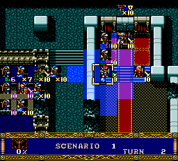
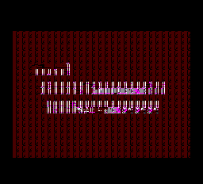
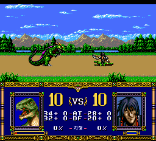
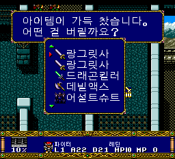

# v0.81 상태 아이콘·12장 이후 영상·전투 BGM 수정

[이슈 #10](https://github.com/OldManCraveGuitars-bit/PCE-Langrisser-Kr/issues/10)에서
제보된 존·사일런스 상태 아이콘, 12장 이후 영상의 음성·그래픽,
13장 전투에서 배경음이 처음부터 다시 재생되는 경로를 수정했습니다.
최종 배포 빌드는 **V387**이며 v0.8의 기존 수정도 포함합니다.

**에뮬레이터 검증을 마친 시험판입니다. 이번 변경의 실기 확인은 아직 하지 못했습니다.
12장 랑그릿사 획득 시 아이템 이름·아이콘이 깨지는 별도 제보는 미해결입니다.**
해당 증상은 보관 중인 저장과 재현 조건으로 나타나지 않아 수정 완료로 처리하지 않았습니다.

## 1. 존·사일런스 상태 아이콘

한글 글꼴의 일부를 상태 아이콘으로 읽던 참조를 수정했습니다.
v0.8에서 복구한 명령·어택·실드 아이콘에 더해, 누락된 상태 도형 3개를
별도 칸에 복구하고 원래 일본판 도트로 연결했습니다.
마법 효과 계산·소모 MP·습득 조건은 변경하지 않았습니다.

| 존 상태 표시 검사 | 사일런스 상태 표시 검사 |
| --- | --- |
|  |  |

두 화면은 V385에서 상태 플래그를 설정해 표시 경로를 확인한 **진단 조건의 실제 출력**입니다.
아이콘 도트가 일본판과 일치하는지 확인했으며, 실제 마법 메뉴에서 시전하는
전체 과정이나 실기 구동을 입증하는 화면은 아닙니다.
이 수정은 V387에 포함되며, 12장→13장 전환 후에도 해당 코드가 유지되는 것을 확인했습니다.

## 2. 12장 이후 영상의 음성·그래픽

영상의 음성 재생을 시작한 뒤 이전 필드 BGM 설정으로 덮어쓰던 경로를 수정했습니다.
해당 영상의 CD 재생·대기 처리를 원래 방식으로 복구하면서 기존 자막 로딩은 유지했습니다.
음원 파일을 교체하거나 에뮬레이터 코어를 수정한 것이 아닙니다.

| 수정 전 — v0.8 / V384 | 수정 후 — V386, v0.81에 포함 |
| --- | --- |
|  |  |

해당 영상의 그림 영역을 일본 원판 실행과 대조했습니다.

| 검사 | 수정 전 | 수정 후 |
| --- | ---: | ---: |
| 비교한 출력 프레임 | 4,034장 | 3,979장 |
| 원판 그림과 대응하지 않는 프레임 | 348장 | 0장 |
| 음성 재생 명령·인자 | 원판과 불일치 | 원판과 일치 |

자막 영역을 제외한 그림과 순서 비교입니다. 음성 복구는 원판과 같은 재생 명령·인자로
검증했으며, 실기 청취 확인을 뜻하지 않습니다.
최종 V387에서도 영상 진입 시 재생 명령과 대표 시점 5곳의 VRAM이 수정판과 일치했습니다.
위 비교 화면의 일본어는 원래 그림에 포함된 문구입니다. 이번 작업은 그래픽·재생 경로
수정이며 해당 이미지 문구의 신규 번역을 포함하지 않습니다.

## 3. 13장 전투 BGM 재시작

대형 전투 그래픽을 CD에서 읽은 뒤 BGM을 곡의 시작 위치로 다시 요청하던 부분을
현재 재생 위치에서 이어 재생하도록 수정했습니다.
원래 반복 시작·끝 위치는 유지하고, 호출 뒤 공용 재생 설정도 복구합니다.



새 부팅에서 이어진 13장 전투를 단축 조건으로 진행해 다음을 확인했습니다.

- 데이터 읽기 전후 재생 위치가 유지되고 처음 위치로 다시 찾지 않음.
- 곡 끝에서는 원래 반복 시작점으로 정상 복귀함.
- 양쪽 대형 그래픽 로더와 연속 읽기 조건에서도 이어 재생함.
- 전송된 전투 그림 데이터가 일본 원판과 같음.

사진만으로 음성 동작을 증명하는 것은 아닙니다. 위 결과는 함께 기록한 CD 명령,
재생 위치, 반복 경계와 VRAM 검사에 근거합니다.
**CD 데이터를 읽는 동안의 짧은 소리 공백까지 없애는 수정은 아닙니다.**
Turbo EverDrive Pro 등 실기의 이어 재생 동작은 추가 확인이 필요합니다.

## 아직 남은 아이템 제보

**12장 클리어 후 랑그릿사의 이름·아이콘이 깨지는 제보는 미해결입니다.**
이미 랑그릿사 2개를 가진 가득 찬 목록으로 원래 보상 처리를 실행해 추가 획득,
15종 아이템 표시·스크롤, 넘친 아이템 폐기, 13장 저장까지 검사했지만 제보 증상은
재현되지 않았습니다. 이 버전에서 아이템 코드나 보상 내용을 바꾸지는 않았습니다.



이는 진단용 보유 목록을 설정한 검사이며, 제보자의 저장을 재현한 것은 아닙니다.
이슈 #10 전체를 해결 완료로 처리하지 않습니다.

## 수정 범위와 검증 한계

- 관련 코드 테스트 **27개 통과**. V387에서 12장 보상→영상→13장 진입,
  아이콘 코드 유지, 대형 전투 그림 읽기와 음악 반복을 약식으로 재검사했습니다.
- V386에서 V387로 바뀐 부분은 Track 2의 3개 데이터 섹터입니다.
  상태 아이콘·영상 수정은 앞선 V385·V386 변경을 포함합니다.
  음원 섹터와 원래 38트랙 구성은 유지하며 추가 39번 트랙은 없습니다.
- v0.708에서 실기 구동 성공이 보고된 글꼴 읽기 방식을 유지했습니다.
  **그 결과가 v0.81의 새로운 음악 처리까지 실기로 검증했다는 뜻은 아닙니다.**
- 재현을 위한 위치·상태·보유 목록 조건은 격리된 검사 실행에서만 사용했습니다.
  시험용 값과 검사 프로그램은 배포 게임에 들어 있지 않습니다.
- 일반·초 랑그 1~20화 전체 자연 플레이, 모든 마법·영상·아이템 조합,
  모든 실기 구성에 대한 정상 동작을 보증하지 않습니다. 게임 내 저장은 먼저 백업하세요.
- 스크린샷은 원본 크기의 실제 에뮬레이터 PNG이며 합성·색 보정을 하지 않았습니다.
  맨 위 타이틀은 기존 V368 캡처, 상태 아이콘은 V385, 수정 후 영상은 V386,
  전투·아이템 재검수는 최종 V387 캡처입니다.

## 다운로드와 적용

[v0.81 릴리스 — Windows 패처 EXE와 수동 BPS ZIP](https://github.com/OldManCraveGuitars-bit/PCE-Langrisser-Kr/releases/tag/v0.81)

1. `PCE-Langrisser-Kr-v0.81-Patcher.exe`를 실행하고 본인 소유의 지원 일본 원본 ISO를
   선택합니다. 이전 한글판에 덧씌우지 마세요.
2. 별도 결과 폴더에 생성된 `LANGRISSER_KR_ISSUE10_V387.bin`과 `.cue`를 함께 두고
   **CUE로 새로 부팅**합니다. 내부 이름 V387은 정상입니다.
3. 이전 세이브스테이트 자동 불러오기는 끄세요. 기존 게임 내 저장 파일은 백업하세요.
4. 수동 적용은 ZIP의 BPS를 일본 원본에 적용하고, 결과 BIN 이름을 위 이름으로 지정한 뒤
   동봉된 CUE와 함께 실행합니다.

약 560 MB의 출력 공간이 필요합니다. EXE에는 BPS 차분과 CUE만 포함하며 원본 게임·BIOS는
배포하지 않습니다. 원본 크기·SHA-256·BPS CRC와 결과 BIN·CUE를 검사하고 기존 파일은
덮어쓰지 않습니다. ZIP에는 상세 변경 내용·검사 기록·스크린샷을 함께 담았습니다.

지원 일본 원본 SHA-256:

```text
ECE10A51AABD107E7F4B83DACA1DEC7B3B0B43D7C15FCFBAE89E840C77910E68
```

v0.81 결과 BIN SHA-256:

```text
9DBBD9A0541D996EDA3F31FC4EC57E68727C92E9E53A972229D42D5237BB9E64
```

보고서의 `published: false`나 빌드 직후의 검증 상태는 기록 생성 당시의 값입니다.
후속 결과는 `integrated-audit.json`, `bgm-audit.json`, `patcher-test.json`을 참고하세요.
기존 v0.8 이하 릴리스 파일과 태그는 교체하지 않았습니다.
