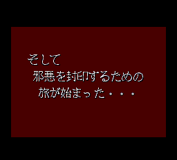
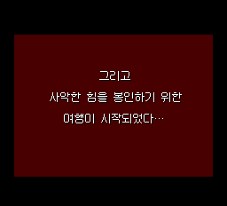

# v0.815 — 12장 이후 영상 문구 한글화

12장 이후 영상에 일본어로 남아 있던 글씨 그림을 한국어로 교체했습니다.
최종 빌드는 **V388**이며, v0.81의 상태 아이콘·영상 음성·전투 BGM 수정과
이전 한글화 작업을 포함합니다. 기존 v0.81 릴리스와 파일은 보존합니다.

## 바뀐 화면

| 기존 일본어 문구 | v0.815 한글 문구 |
| --- | --- |
|  |  |

표시 문구:

> 그리고  
> 사악한 힘을 봉인하기 위한  
> 여행이 시작되었다…

별도 자막을 덧씌우지 않고 **원래 영상의 글씨 타일과 배치 데이터**를 교체했습니다.
기존의 흰 글씨·검은 그림자·적갈색 배경과 문구 표시 시점을 유지했습니다.
가운데 정렬한 세 줄이며, 프로젝트에서 사용하던 12픽셀 한글 도트를 사용했습니다.

새 화면은 V388을 새로 부팅하여 컨트롤러 입력으로 영상보기에 들어가 촬영한
256×232 원본 PNG입니다. 이 캡처 실행에는 진단용 RAM 쓰기가 없습니다.
이미지 합성·확대·가독성 보정을 하지 않았습니다.
왼쪽은 기존 V386 캡처이며 그 일본어 그림은 v0.81/V387에서도 유지됐습니다.
맨 위 메인 화면은 기존 V368 캡처로, 이번 버전의 재촬영으로 표기하지 않았습니다.

## 변경 범위

- 원래 타일 76칸 중 75칸, 원래 압축 공간 1,619바이트 중 1,360바이트를 사용합니다.
  새 영역을 할당하거나 영상 로더를 확장하지 않았습니다.
- v0.81/V387 대비 Track 2의 여섯 섹터만 변경했습니다.
  대상은 글씨 그림·배치 데이터와 그 복제본이며 섹터 EDC/ECC도 갱신했습니다.
- 게임 실행 코드, 영상 시간표, 팔레트, 기존 자막 처리, 음원 데이터는 바꾸지 않았습니다.
- 원래 38트랙 구성을 유지합니다. 추가 39번 트랙은 없습니다.
- v0.81의 존·사일런스 아이콘, 12장 이후 영상 재생, 전투 BGM 이어 재생 수정은 유지합니다.
  v0.8의 명령·어택·실드 아이콘과 상점 스크롤, v0.75의 마법명·페이지 화살표 수정도 포함합니다.

## 확인한 범위

| 검사 | 결과 |
| --- | --- |
| 관련 코드 테스트 | 기존 회귀 테스트 포함 32개 통과 |
| 새 부팅 영상보기의 그림 대조 | 3,979프레임, 예상 밖 차이 0건·순서 오류 0건 |
| 그중 한글 문구 표시 | 348프레임이 원래 프레임의 팔레트를 적용한 번역 기대 그림과 일치 |
| 나머지 영상 그림 | 독립적으로 새 부팅한 일본 원판과 일치 |
| 실제 문구 타일·배치 | VRAM 두 시점에서 한글 데이터와 일치 |
| 음성 재생 명령 | 원판 및 이전 수정판의 정상 값과 일치 |
| 12장 보상→영상→13장 | 게임 내 저장을 새 부팅한 단축 조건 검사 통과 |
| 13장 도달 상태 | 보유 목록·아이콘 및 음악 코드·문구 외 VRAM 다섯 시점이 V387과 일치 |

그림 대조는 기존 자막 띠를 제외한 영상 영역을 대상으로 했습니다.
모든 자막 타이밍 검사나 사람이 전 구간을 청음한 결과로 해석하지 마세요.
12장 이후 검사는 약식 진행이며 자연 전투를 끝까지 클리어한 검사가 아닙니다.
진단 조건은 배포 게임에 포함되지 않습니다.

## 적용 방법

1. `PCE-Langrisser-Kr-v0.815-Patcher.exe`를 실행하고 본인 소유의 지원 일본 원본 ISO를
   선택합니다. 이전 한국어판에 덧씌우지 마세요.
2. 별도 출력 폴더에 BIN·CUE를 만듭니다. 약 560 MB의 여유 공간이 필요합니다.
3. `LANGRISSER_KR_KOREAN_CARD_V388.bin`과
   `LANGRISSER_KR_KOREAN_CARD_V388.cue`를 같은 폴더에 두고 **CUE로 새로 부팅**하세요.
4. 이전 버전 세이브스테이트 자동 로딩을 끄세요. 게임 내 저장 파일은 먼저 백업하세요.

수동 ZIP에는 BPS·CUE·설명·검사 기록·스크린샷을 넣었습니다.
BPS는 일본 원본에 적용하고 위 BIN 파일명으로 저장하세요.
원본 게임·BIOS·사용자 저장 데이터는 포함하지 않습니다.
EXE는 원본을 수정하지 않으며 기존 출력 파일도 덮어쓰지 않습니다.

지원 일본 원본 SHA-256:

```text
ECE10A51AABD107E7F4B83DACA1DEC7B3B0B43D7C15FCFBAE89E840C77910E68
```

v0.815 결과 BIN SHA-256:

```text
9553980A0CCC6F7B881D3BE0827E9E12A8ED797D5566B7971669AAFF6CFF4B12
```

결과 CUE SHA-256:

```text
0CC76089C303DC94B1870708BB6D164C742DA704C898CCA7BCE1213C7A49F4A7
```

## 남은 문제와 한계

- **이번 변경의 실기 재검증은 아직 하지 못했습니다.**
  v0.708의 실기 구동 성공 보고가 후속 버전 전체의 실기 보증을 의미하지는 않습니다.
- **12장 랑그릿사 획득 시 아이템 이름·아이콘 깨짐 제보는 미해결입니다.**
  [이슈 #10](https://github.com/OldManCraveGuitars-bit/PCE-Langrisser-Kr/issues/10)은 닫지 않습니다.
  이번 문구 교체는 해당 아이템 문제를 고치는 변경이 아닙니다.
- v0.81부터의 CD 이어 재생은 에뮬레이터에서 확인했습니다.
  실기 재검증과 CD 읽기 중 짧은 소리 공백은 별도 확인 대상입니다.
- 전체 자연 플레이, 모든 시나리오·분기·실기 구성의 정상 동작을 보증하지 않습니다.
  [README의 기존 미해결 사항](README.md#아직-남은-문제와-검증-범위)도 유지합니다.

ZIP의 `card-static-audit.json`, `card-runtime-audit.json`, `story-runtime-audit.json`에
이번 수정의 검사 근거를 넣었습니다. 각 보고서의 게시 여부·검증 대기 표시는
기록 생성 당시 상태이며 이후 결과는 이 릴리스 설명과 `patcher-test.json`을 참고하세요.
