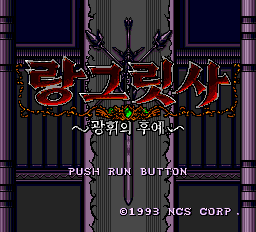
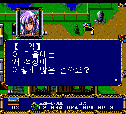
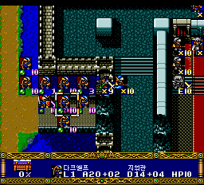
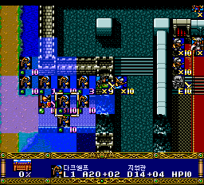
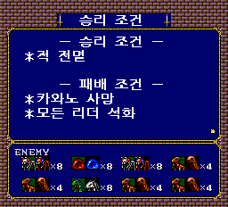
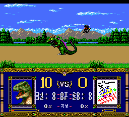

# v0.82 — 보상 아이템·이름·영상 음성 수정, 전투 BGM 개선

최종 빌드는 **V392**입니다. 제보받은 저장 파일을 바탕으로 12장 보상 문제를
수정했고, 이름 첫 글자와 13장 이후 영상 음성을 수정했습니다.
전투 그래픽을 기존 메모리에 무손실 압축해 보관하여, 그림을 읽기 위한 추가
CD 접근 때문에 BGM이 잠깐 끊기던 경로를 제거했습니다.
검수 중 발견한 **초랑그 진입 시 예전 39번 트랙을 읽으려다 멈추는 경로**도 수정했습니다.

**실기 재검증은 하지 못했습니다.** 에뮬레이터 검증 시험판으로 공개하며,
기존 릴리스와 게임 내 저장 파일은 보존해 주세요.

## 수정 내용

### 1. 12장 랑그릿사 획득 시 잘못된 아이템 이름·아이콘

제보된 저장 파일의 아이템 빈칸에는 `FF`뿐 아니라 `AF` 값도 들어 있었습니다.
기존 목록 표시는 두 값을 모두 빈칸으로 처리했지만, 보상 수령 코드는 `FF`만
빈칸으로 판단하여 잘못된 번호를 아이템으로 취급할 수 있었습니다.

- 목록과 보상 수령의 빈칸 판정을 일치시켰습니다.
- 일반·초랑그 40개 시나리오의 두 보상 검사와 코드 복제본에 적용했습니다.
- 제보자 저장 복제본에서 12장을 약식 클리어하고 M·실드와 랑그릿사를 수령했습니다.
  기존 아이템은 유지됐으며 랑그릿사는 2개에서 3개로 늘었습니다.
- 저장 파일 자체를 고치거나 기존 아이템을 삭제하는 처리는 없습니다.

### 2. 나암 이름 앞에 괄호가 하나 더 보이던 현상



실제로 괄호가 중복 입력된 것이 아니라, 글꼴을 처음 읽어 오는 과정에서
첫 글자 코드가 손실되는 문제였습니다. 로딩 전후 글자 코드를 보존하도록
수정해 `【나암】`으로 표시됩니다. 이름 문자열·글꼴 그림은 변경하지 않았습니다.

### 3. 13장 이후 영상에 전투·필드 BGM이 섞이던 문제

영상 14에서 불필요한 필드 글꼴/BGM 복구 호출을 제거하고 원래 영상의
음성 범위 설정·재생·상태 확인 절차를 복구했습니다.
제보자 저장에서 13장 석화 해제, 약식 클리어, 전과보고, 저장,
영상 14, 14장 설명 화면으로 이어지는 경로를 확인했습니다.
해당 영상에는 요청대로 별도 자막을 추가하지 않았습니다.
음성 확인은 원판과 같은 재생 명령·상태 추적이며 전 구간 청음 완료는 아닙니다.

### 4. 전투 중 BGM의 짧은 공백 개선

- 원본 전투 그림 8종을 무손실 압축해 기존 48 KiB 캐시에 함께 보관합니다.
- 좌우 전투원과 초기 기본 그림을 CD 대신 해당 캐시에서 읽습니다.
- 추가 RAM이나 음성/효과음용 ADPCM 공간을 차지하지 않습니다.
- 배경음악의 정상 반복과 다음 턴의 원래 음악 변경은 유지합니다.
- 음원 파일, 효과음 샘플, 트랙 배치는 변경하지 않았습니다.

일반 경로의 전투 13회에서 게임에 쓰이는 그림 유형 0~6과 원본 픽셀 일치,
추가 CD 읽기 0회, BGM 진행·반복, 필드 복귀 아이콘을 확인했습니다.
유형 7은 해당하는 게임 클래스가 없어 명령어 실행 검사로 확인했습니다.
이 결과는 CD 읽기로 인한 공백 원인을 제거했다는 근거이며, 모든 환경의
오디오 지연이나 실기 재생 품질까지 보증하는 것은 아닙니다.

### 5. 존·사일런스 실제 시전 재검증

| 존 시전 후 | 사일런스 시전 후 |
| --- | --- |
|  |  |

기존 아이콘 수정을 유지하며 실제 마법 메뉴에서 시전해 MP 감소, 적 상태 적용,
원본 아이콘 표시를 다시 확인했습니다. 시전자 클래스·MP만 진단용으로 제공했고,
적의 상태·위치·난수를 직접 바꾸어 성공한 것으로 처리하지 않았습니다.
예전 버전의 세이브스테이트는 불러오지 말고 새 부팅 후 게임 내 저장을 사용하세요.

### 6. 초랑그 진입 경로 수정과 검증

| 초랑그 13장 승리 조건 | 초랑그 실제 용 전투 |
| --- | --- |
|  |  |

초랑그 선택 뒤의 초기화 코드에 폐기된 모듈을 예전 39번 트랙에서 읽으려는
경로가 남아 있었습니다. 없는 주소를 반복해서 읽던 이 절차를 제거하고,
현재 공통 글꼴 로더를 그대로 사용하도록 했습니다. 시나리오 본문·맵을 읽는
원래 두 절차와 시나리오 선택 표는 보존했습니다.

최종 V392에서 다음 항목을 확인했습니다.

- 초랑그 1~20장 각각 새 부팅 진입, 시나리오 번호·대사 데이터 전체·현재 글꼴 로더·전투 캐시 일치.
- 초랑그 13장 실제 용 전투: 초기/좌우 그림 원본 일치, 추가 CD 읽기 0회,
  ADPCM 64 KiB 불변, BGM 구간 반복, 필드의 인물 퇴각 대사와 아이콘으로 복귀.
- 초랑그 13장 약식 클리어→전과보고·저장→14장 진입 및 다음 장 대사 데이터 일치.
- 수정 관련 자동 테스트 총 **49개 통과**.

용 전투는 행동 완료 플래그 1바이트만 초기화했으며 실제 부대 클래스·위치는 바꾸지 않았습니다.
13→14장 전환은 별도 분기에서 적 격파 플래그와 원래 이벤트 진입 조건을 단축한 검사입니다.
검증 상세 결과는 ZIP의 `extra-runtime-audit.json`에 기록했습니다.
시나리오 선택과 클리어 조건 단축은 격리된 진단 실행에만 적용되며 배포 게임에는
포함되지 않습니다. 1~20장 진입 검사는 20장 전체 자연 플레이 완료와 다릅니다.

## 적용 방법

1. `PCE-Langrisser-Kr-v0.82-Patcher.exe`를 실행해 본인 소유의 지원 일본 원본 ISO를 선택합니다.
   이전 한국어판에 덧씌우지 마세요.
2. 별도 출력 폴더를 지정합니다. 약 560 MB의 여유 공간이 필요합니다.
3. 생성된 `LANGRISSER_KR_EXTRA_CACHE_V392.bin`과 `.cue`를 같은 폴더에 두고
   **CUE로 새로 부팅**합니다.
4. 이전 버전의 세이브스테이트 자동 로딩을 끄고 게임 내 저장 파일을 백업하세요.

수동 ZIP에는 BPS·CUE·설명·검사 기록·스크린샷을 넣었습니다.
원본 게임·BIOS·사용자 저장 파일은 포함하지 않습니다.
원래 38트랙 구성이며 추가 39번 트랙은 없습니다. 원본과 기존 출력은 덮어쓰지 않습니다.

지원 일본 원본 SHA-256:

```text
ECE10A51AABD107E7F4B83DACA1DEC7B3B0B43D7C15FCFBAE89E840C77910E68
```

v0.82 결과 BIN SHA-256:

```text
801557BA62876519FC2B1688B9F3F62C3AA3C3B2085DF6B518B86A36C633F58F
```

결과 CUE SHA-256:

```text
D96367F07F8221EF2130253B226334974C0F88B39C7390B481917BDF2102410A
```

## 검증 범위와 남은 한계

- 실기 검증은 진행하지 않았습니다. v0.708의 실기 성공 보고를 이번 버전 전체의 보증으로 보지 마세요.
- 이전 V390의 제보자 저장·이름·연속 영상 검사와 V391의 일반 전투·실제 시전 결과를
  구분해 기록했습니다. V392는 그 데이터를 유지하고 초랑그의 낡은 초기화 코드 두 복사본만 바꿨습니다.
- 전체 자연 플레이, 모든 대사·선택지·영상·후일담 전수 검사가 아닙니다.
- 기존 일반 1장 하단 직업/이름 줄의 금색 타일 혼입 등 이번 수정 범위 밖의 문제는 계속 남습니다.
- 이슈 #10은 제보자의 새 버전 재확인을 받기 전까지 닫지 않습니다.
- 검사 JSON의 `published=false`, 검증 대기 문구는 해당 기록 생성 당시 상태입니다.
  이후 검증 범위와 배포 여부는 이 설명과 `patcher-test.json`을 참고하세요.

화면은 실제 에뮬레이터 원본 PNG이며 합성·색 보정·도트 수정은 하지 않았습니다.
맨 위 타이틀은 기존 V368, 이름은 V390, 마법 시전은 V391, 초랑그는 최종 V392 캡처입니다.
캡처 출처·해시는 ZIP의 `screenshot-manifest.json`에 포함합니다.
