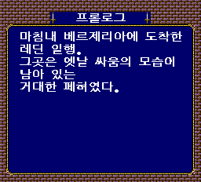
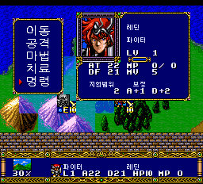
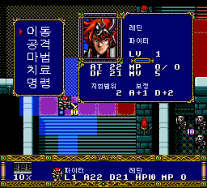
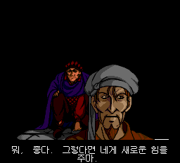

# v0.83 — 17→18장 프리징·영상 BGM 수정

최종 빌드는 **V396**입니다. [이슈 #11](https://github.com/OldManCraveGuitars-bit/PCE-Langrisser-Kr/issues/11)의
13장 이후 영상 BGM 문제와 17장 클리어 후 18장 진입 멈춤에 대응했습니다.
기존 한글화와 v0.82의 보상 아이템·이름·전투 그래픽 캐시·초랑그 진입 수정을 포함합니다.

**에뮬레이터 검증 시험판이며 실기 재검증은 하지 못했습니다.**
기존 릴리스와 게임 내 저장 파일은 보존해 주세요.

## 1. 연속 진행 중 17→18장 전환 프리징 수정

독립적으로 18번 영상을 여는 검사만으로는 나오지 않던 멈춤을,
13장에서 시작해 연속으로 다음 장에 진입하는 경로에서 재현했습니다.
자막용 임시 코드가 원래 게임의 시나리오 전환용 복귀 주소와 겹치는 것이 원인이었습니다.

- 자막용 92바이트 작업 영역을 원래 게임 스택과 겹치지 않는 영상 전용 영역으로 옮겼습니다.
- 임시 영역을 참조하는 자막 코드와 세 가지 프레임 호출 경로를 함께 갱신했습니다.
- 영상이 끝나면 임시 호출 대상과 작업 영역을 복구하도록 했습니다.
- 게임 스택을 강제로 비우거나 복귀 주소를 임의로 고쳐 넘어가는 방식은 사용하지 않았습니다.

| 17장 클리어 후 18장 설명 | 18장 첫 턴 명령 메뉴 | 20장 첫 턴 명령 메뉴 |
| --- | --- | --- |
|  |  |  |

기술적으로 기존 작업 영역 `26E6~2741`은 원래 게임의 소프트웨어 스택
`2648~2747` 안에 있었습니다. 이전 빌드에서 실제 사용 중인 `273C`의 복귀 값이
자막 초기화로 바뀌어 잘못된 위치로 되돌아갔습니다. 새 영역은 고정 영상 RAM의
`4F98~4FF3`이며, V396에서는 해당 복귀 값과 원래 스택 커서 진행이 유지됨을 확인했습니다.
작업 영역 92바이트의 쓰기 추적과 진입·종료 시 저장/복구 검사도 통과했습니다.

## 2. 영상 음성 위에 필드 BGM이 다시 나오던 문제 수정

일부 영상 진입 코드가 원래 음성을 재생한 뒤 필드 글꼴/BGM 복구 처리를 불러,
이전 지도 음악이 영상 음성을 덮어쓰는 경로가 있었습니다.
원래 영상의 음성 범위 설정·재생·상태 확인 순서를 복구하고 자막 진입과 분리했습니다.



- 영상보기 1~20번의 원래 음성 재생 명령과 정상 종료를 확인했습니다.
- 영상 음성 재생 중 잘못된 필드 BGM 복구 호출이 발생하지 않는 것을 추적했습니다.
- 17→18장 연속 경로에서 영상 음성 재생과 영상 종료가 각각 한 번 진행됨을 확인했습니다.
- 음원 파일·효과음 샘플·원래 38트랙 배치는 바꾸지 않았습니다.

음성 검증은 재생 명령과 상태 기록을 기준으로 했으며 모든 구간을 사람이
끝까지 청음했다는 뜻은 아닙니다. 기존에 자막을 넣지 않은 영상에 새 자막을 추가하지 않았습니다.

## 3. 자막·화면 및 게임 진입 회귀 검사

자막 작업 영역을 옮기는 과정에서 자막 시작이 늦어질 수 있는 공통 호출 경로를
함께 점검했습니다. 최종 V396에서는 세 호출 경로 모두 새 영역을 가리키고,
영상 종료 때 원래 대상으로 복구됩니다. 중간 후보 V394·V395는 배포하지 않습니다.

- 영상보기 1~20번에서 각 5개 고정 갱신 시점의 자막 상태와 시계를 기준 빌드 V393과 대조했습니다.
- 정확히 같은 갱신 시점의 화면 **108쌍**이 픽셀 단위로 일치했습니다.
  V393은 음성 수정 후의 비교 기준이며, 이번에 고친 연속 진행 프리징은 남아 있던 빌드입니다.
- 자막 그림·시간표·콜드 부팅 오프닝 데이터는 이번 수정에서 변경하지 않았습니다.
- 세이브스테이트나 진단용 RAM 조작 없이 새 게임을 시작해 1장 한국어 대사까지 확인했습니다.
- 관련 기능·정적 테스트 **172개**가 통과했습니다.

## 검증 범위와 한계

하나의 게임 내 저장에서 시작해 일반 **13→14→15→16→17→18→19→20장**을
연속 검사했습니다. 13~19장은 격파·이벤트 조건을 단축해 클리어했고,
13~20장 첫 턴 명령 메뉴와 다음 장 대사·글꼴·캐시 데이터를 확인했습니다.
이 진단 조건은 배포 게임에 들어 있지 않습니다.

- **자연 전투 전체 진행이나 20장 클리어 검사가 아닙니다.**
- 이번 연속 진행 검사는 일반 시나리오이며, 초랑그 전체를 새로 재검증하지 않았습니다.
- 제보자의 저장 파일·에뮬레이터 코어는 받지 못했습니다. 멈춤은 재현했지만
  제보 사진의 금색 타일 모양까지 똑같이 재현한 것은 아닙니다.
- 실기와 제보자 환경에서의 재확인은 남아 있습니다. v0.708의 실기 성공 보고는
  v0.83 전체의 실기 보증이 아닙니다. 이슈 #11은 재확인 전까지 열어 둡니다.
- 108쌍은 표본 대조이며 영상의 모든 프레임을 검사한 결과는 아닙니다.
- 일반 1장 하단 직업/이름 줄의 금색 타일 혼입 등 이번 수정 범위 밖의 기존 문제는 남아 있습니다.

## 적용 방법

1. `PCE-Langrisser-Kr-v0.83-Patcher.exe`를 실행해 본인 소유의 지원 일본 원본 ISO를 선택합니다.
   이전 한글판에 덧씌우지 마세요.
2. 별도 출력 폴더를 지정합니다. 약 560 MB의 여유 공간이 필요합니다.
3. 생성된 `LANGRISSER_KR_MOVIE_FRAME_V396.bin`과 `.cue`를 같은 폴더에 두고 **CUE로 새로 부팅**합니다.
4. 이전 버전 세이브스테이트 자동 로딩은 끄고 게임 내 저장 파일을 백업하세요.

수동 BPS ZIP에는 차분·CUE·설명·검사 기록·스크린샷을 넣었습니다.
원본 게임·BIOS·사용자 저장 파일은 포함하지 않습니다. 추가 39번 트랙은 없습니다.
원본과 기존 결과는 덮어쓰지 않습니다.

지원 일본 원본 SHA-256:

```text
ECE10A51AABD107E7F4B83DACA1DEC7B3B0B43D7C15FCFBAE89E840C77910E68
```

v0.83 결과 BIN SHA-256:

```text
B63B96BD40111E845755E63645F01D544E2131CE65D3BCDCC2FE6A158A5D1ED1
```

결과 CUE SHA-256:

```text
7F851BE45E2610017DC9692EC2E70FD5E7037F86D8291E860BD2729D98343D07
```

검사 JSON의 `published=false`와 정적 빌드 기록의 검증 대기 문구는 각 파일 생성 당시
상태를 보존한 것입니다. 최종 실행 검사 결과는 `issue11-runtime-audit.json`,
배포 패처 검사는 `patcher-test.json`을 참고하세요.

이번 네 화면은 최종 V396의 무보정 에뮬레이터 원본 PNG입니다.
맨 위 타이틀은 기존 V368 캡처이며 새로 촬영한 것으로 표시하지 않았습니다.
원본 경로·SHA-256은 ZIP의 `screenshot-manifest.json`에 기록했습니다.
