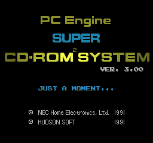
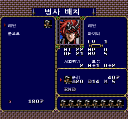
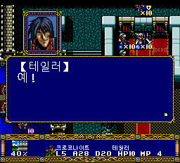

# v0.831 — Mesen CE 부팅 호환성 수정

최종 빌드는 **V397**입니다. Mesen CE 2.2.1에서 정상 BIOS를 사용해도
`JUST A MOMENT...` 화면에서 멈추던 문제를 수정했습니다.
v0.83의 17→18장 연속 진행 프리징·영상 BGM 수정과 기존 한글화를 포함합니다.

**에뮬레이터 검증 시험판이며 실기 재검증은 하지 못했습니다.**

## 수정 전후

| Mesen CE 2.2.1: 기존 v0.83 | Mesen CE 2.2.1: v0.831 |
| --- | --- |
|  |  |

같은 정상 BIOS와 같은 입력 순서로 비교한 실제 에뮬레이터 출력입니다.
수정 후 Mesen 2.1.1과 Mesen CE 2.2.1 모두 새 게임의 병사 배치까지 진행됐습니다.
두 버전의 최종 화면 픽셀과 38개 트랙 경계가 기존에 동작하던 Mesen 2.1.1 기준과 일치합니다.



위 세 검수 화면은 무보정 출력입니다. 맨 위 타이틀은 기존 공개 V368 캡처입니다.

## 원인과 수정

기존 단일 BIN의 CUE는 트랙 2 앞 3초와 트랙 3 앞 2초의 공백을 `PREGAP`으로 지정했습니다.
이 공백은 BIN 안에 저장되지 않고 CD 읽기 프로그램이 만들어 주는 형태였습니다.
Mesen CE 2.2.1의 [CUE 공백 계산 변경](https://github.com/nesdev-org/MesenCE/commit/8b4f65dd1687aec5246c08230882bed4bd8f67dd) 이후,
이 구성에서는 앞선 공백이 누적되지 않아 데이터 트랙의 끝을 225섹터 짧게 계산했습니다.

기존 v0.83의 데이터 트랙은 게임 기준 LBA `15337~20640`인데,
Mesen CE 2.2.1은 `15337~20415`로 해석했습니다.
한글판 초기화가 사용하는 LBA `20492 (0x500C)`가 이 잘못된 범위 밖에 놓여 부팅이 멈췄습니다.
일본 원판은 해당 추가 데이터 읽기를 사용하지 않아 같은 환경에서도 부팅됐습니다.

v0.831은 두 공백을 BIN 안에 실제 저장하고 CUE의 `INDEX 00/01`로 표시합니다.
이렇게 하면 공백 누적 해석에 의존하지 않고 원래 CD 위치를 표현할 수 있습니다.

- 38개 실제 트랙 데이터가 기존 v0.83과 모두 바이트 단위로 동일합니다.
- 게임이 보는 트랙 번호·시작 위치·전체 CD 길이를 유지합니다. 추가 39번 트랙은 없습니다.
- BIN은 공백 375섹터, **882,000바이트**만큼 커집니다.
- 게임 코드·한글 번역·글꼴·자막·음성·BGM·게임 내 저장 형식은 변경하지 않았습니다.
- Mednafen의 CD Layout ID는 `a614d746ad2fb58de83bcb0f99d838ff`로 유지됩니다.

## 이번 버전에서 확인한 범위

| 환경·항목 | 확인 결과 |
| --- | --- |
| Mesen 2.1.1 | 정상 BIOS로 새 게임 병사 배치까지 부팅 |
| Mesen CE 2.2.1 | 정상 BIOS로 새 게임 병사 배치까지 부팅, 기존 멈춤 해소 |
| Mednafen | 세이브스테이트·게임 내 저장·RAM 조작 없이 새 게임에서 1장 한국어 대사까지 진행 |
| 1장 게임 상태 | 고정 갱신 시점 4곳의 RAM·VRAM 총 8개 덤프가 v0.83과 완전히 동일 |
| 영상 1·15·18·20번 | 원래 음성 재생 명령과 정상 종료 경로 통과 |
| CD 구성 | 38개 트랙 데이터·위치·전체 길이 및 Mednafen CD Layout ID 동일 |
| Windows 패처 | 실제 EXE를 원본에 적용해 최종 V397과 일치, Floating IPS로도 독립 적용 검증 |

이는 전체 캠페인 재플레이나 영상 전 구간 청음 검사가 아닙니다.
Mesen에서는 병사 배치까지 부팅을 확인했으며 전체 전투·시나리오 전환을 다시 검수하지 않았습니다.
실기와 제보자 환경에서의 재확인은 남아 있습니다.
기존 v0.83에서 수행한 연속 시나리오·영상 검사는 [v0.83 변경 기록](RELEASE_NOTES-v0.83.md)에 구분해 두었습니다.

## 적용 방법

1. `PCE-Langrisser-Kr-v0.831-Patcher.exe`를 실행하고 지원 일본 원본 ISO를 선택합니다.
2. 새 출력 폴더를 지정합니다. 약 560 MB의 여유 공간이 필요합니다.
3. 생성된 `LANGRISSER_KR_CD_COMPAT_V397.bin`과 `.cue`를 같은 폴더에 둡니다.
4. **새 CUE로 부팅**합니다. 기존 V396 BIN에 새 CUE만 연결하지 마세요.

이전 한글판에 덧씌우지 마세요. 패처는 원본을 읽기 전용으로 검사하며 기존 결과를 덮어쓰지 않습니다.
게임 내 저장 파일은 먼저 백업하고 이전 버전 세이브스테이트 자동 불러오기는 끄세요.
결과 파일명이 바뀌므로 기존 게임 내 저장은 에뮬레이터의 파일명 규칙에 맞춰 옮겨야 할 수 있습니다.

Windows EXE에는 BPS 차분과 CUE만 넣었습니다. 수동 ZIP에는 차분·CUE·안내·검사 기록·스크린샷을 넣었습니다.
원본 게임 이미지·BIOS·사용자 저장 파일은 포함하지 않습니다.

## BIOS 안내

이 수정과 별개로 Mesen은 정상 Super CD-ROM System 3.0 BIOS가 필요합니다.
일본 v3.0 BIOS의 정상 크기는 **262,144바이트(256 KiB)**입니다.
Mednafen이 받아들이는 일부 헤더·추가 데이터가 포함된 파일은 Mesen에서 크기 검사로 거부될 수 있습니다.
이 패처는 BIOS를 수정하거나 제공하지 않습니다.

검수에 사용한 정상 BIOS SHA-256:

```text
E11527B3B96CE112A037138988CA72FD117A6B0779C2480D9E03EAEBECE3D9CE
```

## 파일 검증

지원 일본 원본 크기: **559,051,584바이트**

```text
ECE10A51AABD107E7F4B83DACA1DEC7B3B0B43D7C15FCFBAE89E840C77910E68
```

v0.831 결과 BIN 크기: **559,933,584바이트**

```text
2C917A4DC733D9735E98965EFC0FA8D2F45583292FB26B71DA1A11F1C81CEF18
```

ZIP의 `runtime-audit.json`, `patcher-test.json`, `build-manifest.json`에서
검사 범위와 결과 해시를 확인할 수 있습니다.
