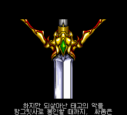
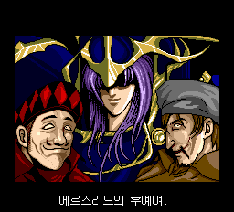
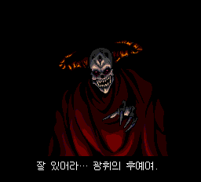
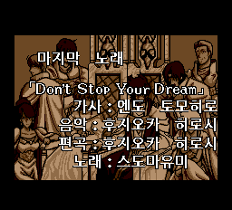

# v0.84 — 번역 검수 반영 시험판

일반·초랑그 대사, 이름, 승리 조건, 후일담, 크레딧과 영상 자막의 **28건**을 수정했습니다.
내부 빌드는 **V398**입니다. v0.831의 Mesen 부팅 호환성과 이전 진행·음성·아이콘 수정을 포함합니다.
**필드 이름·클래스 표기 9건은 미반영입니다. 전체 번역 검수 완료나 전체 자연 플레이 완료를 뜻하지 않습니다.**

## 실제 적용 화면

| 영상 13 | 영상 17 |
| --- | --- |
|  |  |

| 엔딩 A | 엔딩 크레딧 |
| --- | --- |
|  |  |

모두 최종 V398의 256×232 에뮬레이터 원본 PNG입니다. 색·글꼴·픽셀을 수정하거나 합성하지 않았습니다.
크레딧은 같은 V398의 엔딩 B 진행 상태에서 이어 확인했습니다. README 맨 위 타이틀은 기존 V368 화면입니다.

## 수정한 28건

같은 문구라도 서로 다른 대사·조건 레코드에 적용한 경우 각각 계산했습니다.

### 대사·아이템 메시지 11건

| 위치 | 기존 | v0.84 |
| --- | --- | --- |
| 일반 1장 | 아버님과 모두 | 아버님, 모두 |
| 일반 3장 | 끝에 저를 피신시키고, | 마지막에 절 피신시켜, |
| 일반 8장 | 뭣, 왜냐!! | 뭐, 왜지!! |
| 초랑그 8장 | 왜, 왜냐!! | 뭐, 왜지!! |
| 일반 9장 | 서펜 나이트가 / 적진에서 버틴다! | 적에게 / 서펜트나이트가 있다! |
| 일반 10장 아이템 | 판금갑옷 | 플레이트아머 |
| 일반 11장 아이템 | 판금갑옷 | 플레이트아머 |
| 초랑그 7장 | 마사 있습니까! | 마사 씨 있나요! |
| 초랑그 16장 | 전군으로 | 전군을 이끌고 |
| 초랑그 20장 | 더는 못 하게 둬! | 더는 안 된다! |
| 초랑그 6장 아이템 | “워 해머“ | “워해머” |

9장은 적에게 해당 병종이 있다는 원문 의미를 바로잡았습니다. 아이템 메시지는 실제 메뉴 이름과 통일했습니다.
초랑그의 실명 농담과 말투는 유지했습니다. `/`는 화면의 줄바꿈을 나타냅니다.

### 이름·승리 조건 4건

| 위치 | 기존 | v0.84 |
| --- | --- | --- |
| 필드 이름 | 리키워드 | 루키워드 |
| 필드 이름 | 레시아 | 레티시아 |
| 일반 4장 승리 조건 | 12회 | 12턴 |
| 초랑그 4장 승리 조건 | 12회 | 12턴 |

### 후일담·크레딧 9건

| 위치 | 기존 | v0.84 |
| --- | --- | --- |
| 후일담 | 살라스로 돌아가 가족과 | 사르라스로 돌아가 가족과 |
| 후일담 | 일자크 죽자 왕국을 떠나 | 일자크 사후 왕국을 떠나 |
| 후일담 | 검을 배우러 왕국을 떠나 | 검술 연마하러 왕국을 떠나 |
| 일반 크레딧 | 사운드 구상 사무소 | 사운드플래닝오피스 |
| 일반 크레딧 | 편성：후지오카 히로시 | 편곡：후지오카 히로시 |
| 일반 크레딧 | 판매 | 홍보 |
| 초랑그 크레딧 | 라이벌 란스 | 라이벌 랜스 |
| 초랑그 크레딧 | 알베르트 | 알버트 |
| 초랑그 크레딧 | 초 천재 프로그래머 | 초 재난 프로그래머 |

‘홍보’는 원문의 판매 촉진 역할을 기존 두 글자 공간에 맞췄습니다.
‘초 재난 프로그래머’는 원작의 天災/天才 말장난을 반영했습니다.

### 영상·엔딩 자막 4건

| 위치 | 기존 | v0.84 |
| --- | --- | --- |
| 영상 13 자막 4 | 태고의 사악 | 태고의 악 |
| 영상 13 자막 5 | 태어난 사악은 | 태어난 악은 |
| 영상 17 | 엘스리드의 후예여. | 에르스리드의 후예여. |
| 엔딩 A | 잘 있어라… 빛의 후예여. | 잘 있어라… 광휘의 후예여. |

## 남은 9건 — 이번 버전에 미반영

| 현재 필드 표기 | 권장 표기 |
| --- | --- |
| 보르코프 | 볼코프 |
| 도 마토프 | 도 모토프 |
| 베르노이 | 베르누이 |
| 로드 자르다프 | 로드 잘다프 |
| 키르히나 | 키르히너 |
| 바랜츠 | 바렌츠 |
| 마르간 | 모르간 |
| 바시리스크 | 바실리스크 |
| 스켄레토 | 스켈레톤 |

필드의 8×8 작은 글꼴은 숫자·테두리·아이콘과 공간을 공유합니다. 보관된 필드 VRAM
8,310개를 대조해 안전하게 비어 있는 두 자리를 확인했고 ‘루·티’에 사용했습니다.
위 9건에 필요한 추가 글자를 넣으려면 기존 그래픽과 분리하는 글꼴 확장과 실행 검증이 더 필요합니다.
현재 권장안을 게임에 적용했다고 표시하지 않았습니다.

## 번역 관리 툴 복구

로컬 번역 툴 V17이 삭제된 과거 빌드를 요구하던 문제를 고쳤습니다. 현재 V398에서 추출한
**2,910개 항목**을 관리하며, 적용한 28건의 변경 전·후 문구와 미반영 9건을 구분합니다.
일반 대사 1,108개, 초랑그 대사 1,132개, 나레이션 10개, 조건 40개, 인터페이스 241개,
엔딩 239개, 영상 원고·이름 카드 140개입니다. 등록 건수는 번역 완료율을 뜻하지 않습니다.
기존 제안 이력 저장소는 보존했습니다. 이번 패처 배포 자산에 번역 편집기 EXE는 포함하지 않습니다.

## 수정 범위와 검증

- 현재 배포본에서 추출한 한국어 대사 1,985쌍 전체를 읽고, 의심 문구는 일본어 원문과 대조했습니다.
  기존 의미 검수 기록도 연결했습니다. 모든 일본어 원문을 이번에 새로 정독하거나 모든 음성을 재전사한 검수는 아닙니다.
- 일반·초랑그 대사 **2,240개 / 2,291페이지**, 포인터·미러 **4,638건**을 검사했습니다.
  기존 포인터·제어 코드·종료 위치를 보존했고 바뀐 문구를 결과 이미지에서 다시 읽어 확인했습니다.
- Mednafen 새 부팅으로 일반 1장 진입과 작은 글꼴 적재, Mesen CE 2.2.1 새 게임 진입을 확인했습니다.
- 영상 13·17의 수정 자막이 VRAM의 기대 글씨 그림과 일치하고 원래 음성 재생 명령 및 종료 경로가 진행됨을 확인했습니다.
- 엔딩 A의 ‘광휘의 후예’ 자막, 엔딩 B 경유 크레딧의 ‘편곡’, 같은 자막 표를 공유하는 인물 소개를 실행 확인했습니다.
- 큰 글꼴 896자 중 미사용 한 자리를 ‘곡’에 재배정했고 나머지 **895자**는 그대로입니다.
  896자 모두 기존 16 KiB 압축 형식에서 복원·왕복 검사를 통과했습니다.
- 영상 17의 늘어난 자막 그림과 엔딩의 추가 글자 표는 해당 장면의 빈 공간에 배치했습니다.
  영상 시간·프레임 훅을 유지했고 엔딩은 기존 조회 명령 네 곳의 표 주소만 바꿨습니다.
- v0.831의 **38개 트랙 구성과 CUE 공백 처리**를 유지합니다. 변경한 데이터 섹터의 ECC를 다시 만들었습니다.
  변경 섹터 밖의 BIN은 v0.831과 일치하며 CD 음성·BGM·효과음 데이터도 동일합니다.
  실기에서 확인됐던 글꼴 읽기 코드와 상태 아이콘 보조 루틴을 유지했습니다.
- 번역 툴의 원본 연결·변경 감지·제안 이력·페이지 검사 관련 자동 테스트 12개와 실행 파일 자체 검사를 통과했습니다.
- 최종 패처 EXE를 일본 원본에 적용한 결과와 독립 Floating IPS로 BPS를 적용한 결과가 모두 검수한 V398과 일치했습니다.

이번 검사는 **전체 자연 플레이, 모든 영상의 전 프레임 검사·전 구간 청음, 실기 재검증이 아닙니다.**
이전에 확인한 모든 진행 경로를 이번 버전에서 전부 다시 플레이했다고 주장하지 않습니다.
검증 수치와 파일 해시는 ZIP의 `runtime-audit.json`, `translation-review.json`, `patcher-test.json`에 포함했습니다.

## 적용 방법

1. 본인 소유의 지원 일본 원본 ISO에 `PCE-Langrisser-Kr-v0.84-Patcher.exe`를 적용합니다.
   수동 적용은 ZIP의 BPS를 사용합니다. 이전 한글판에 덧씌우지 마세요.
2. 생성된 `LANGRISSER_KR_TRANSLATION_V398.bin`과 같은 이름의 `.cue`를 함께 둡니다.
3. **CUE로 새로 부팅**합니다. 기존 BIN과 새 CUE를 섞어 사용하지 마세요.
4. 게임 내 저장 파일은 백업하고 이전 빌드의 세이브스테이트 자동 로딩은 끄세요.

원본 게임 이미지와 BIOS는 포함하지 않습니다. 정상 Super CD-ROM System 3.0 BIOS는 별도로 필요합니다.
출력 공간은 약 560 MB이며 원본과 기존 결과 파일을 덮어쓰지 않습니다.

지원 일본 원본: 559,051,584바이트 / SHA-256

```text
ECE10A51AABD107E7F4B83DACA1DEC7B3B0B43D7C15FCFBAE89E840C77910E68
```

v0.84 결과 BIN: 559,933,584바이트 / SHA-256

```text
64637801C457AD8A38837D1B74CC522BA9C1C5A38212B6157CD5A0F8098D17C1
```
